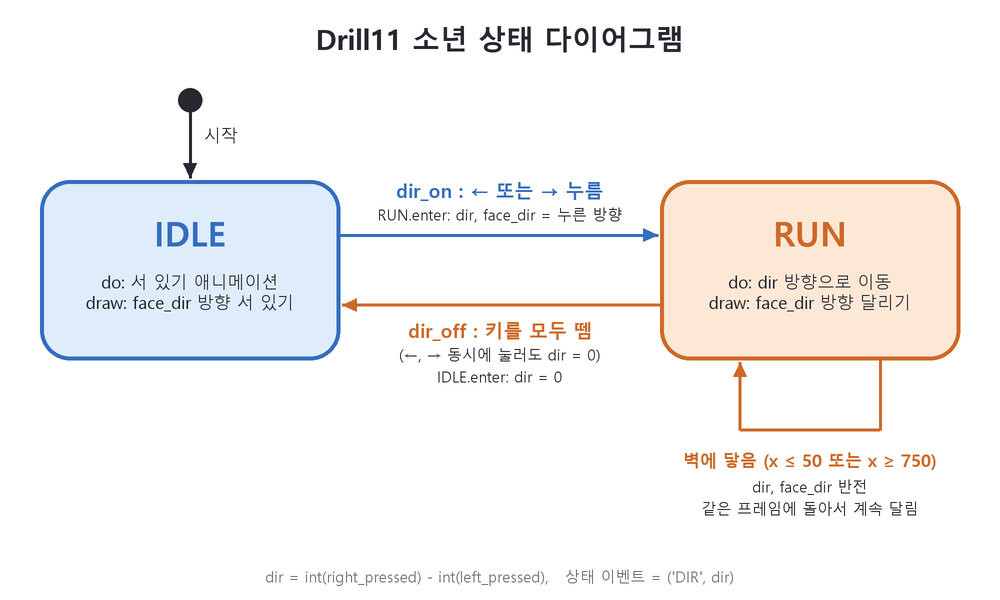

# PRD - Drill #11 클래스와 모듈로 만드는 캐릭터 컨트롤러

## 1. 개요

LEC12(캐릭터 컨트롤러 1)의 **클래스 변수**, **모듈과 소스 코드 분리**, **상태 머신**을 적용해, 잔디 위의 소년을 좌우 방향키로 달리게 하는 pico2d 프로그램을 만든다. 게임 객체(소년, 잔디)와 상태(IDLE, RUN, AUTO_RUN), 상태 머신, 게임 월드를 각각 **클래스와 모듈**로 나눈다.

| 항목 | 내용 |
|---|---|
| 소스 | `main.py`, `game_world.py`, `state_machine.py`, `boy.py`, `grass.py` |
| 리소스 | `animation_sheet.png` (소년), `grass.png` (잔디) |
| 상태 다이어그램 | `state_diagram.png` |
| 라이브러리 | pico2d (`pip install -r requirements.txt`) |
| 실행 | 저장소 폴더에서 `python main.py`, 또는 VS Code로 이 폴더를 열고 Ctrl+F5 |
| 저장소 | https://github.com/baeseongwoo/Drill11.git |

## 2. 요구사항

| ID | 요구사항 | 구현 기준 |
|---|---|---|
| R1 | 모듈 분리 | 역할별로 파일을 나누고 `import`해서 사용 (4절) |
| R2 | 클래스로 구현 | 게임 객체(`Boy`, `Grass`), 상태(`Idle`, `Run`, `AutoRun`), 상태 머신(`StateMachine`)을 모두 클래스로 만든다 |
| R3 | 리소스 로딩 최적화 | 이미지는 클래스 변수 `image`에 한 번만 로드하고 모든 객체가 공유 |
| R4 | 상태 머신 | IDLE / RUN / AUTO_RUN 세 상태. 상태 전이는 `StateMachine`의 규칙 테이블로 처리 |
| R5 | IDLE | 처음 상태. 바라보는 방향의 서 있기 애니메이션 반복 |
| R6 | RUN | ←/→를 누르면 RUN으로 그 방향 달리기, 모두 떼면 IDLE. 좌우를 하나의 RUN 상태로 처리 |
| R7 | RUN 벽에서 멈춤 | 화면 좌우 밖으로 나가지 않는다. 방향키를 계속 누르고 있어도 벽(x 50 / 750)에서 멈추고 방향은 바꾸지 않는다 (자동 방향 전환은 AUTO_RUN에서만) |
| R8 | 종료 | ESC 또는 창 닫기 |
| R9 | 커밋 로그 | 한 커밋에 한 가지 변경, 모든 커밋은 실행 가능한 상태, 25개 이상 (7절) |
| R10 | 상태 다이어그램 | 구현한 상태와 전이를 그림으로 만들어 저장소에 포함 |
| R11 | AUTO_RUN 진입 | IDLE에서 'a' 키를 누르면 AUTO_RUN. 키 조작 없이 바라보던 방향으로 계속 달린다. 반드시 `AutoRun` 상태 클래스로 구현 |
| R12 | AUTO_RUN 모습 | 속도는 RUN의 2배, 크기도 2배로 확대. 커져도 발은 잔디 위에 붙어 있다 |
| R13 | AUTO_RUN 벽 전환 | 커진 몸이 화면 밖으로 나가지 않고, 좌우 끝(x 100 / 700)에서 자동으로 방향 전환 |
| R14 | AUTO_RUN 종료 | 5초 이상 지나면 IDLE로 복귀. 그 전에 방향키를 누르면 무적 런이 취소되고 누른 방향으로 RUN |

범위 밖: SLEEP(잠들기), Dash, 위아래 이동, 충돌 처리.

## 3. 리소스

### 3.1 animation_sheet.png (802 x 402)

100 x 100 칸이 가로 8개(프레임), 세로 4줄(동작). pico2d 기준(이미지 아래쪽에서부터) 줄 위치:

| bottom | 동작 |
|---|---|
| 300 | 오른쪽을 보고 서 있기 (IDLE) |
| 200 | 왼쪽을 보고 서 있기 (IDLE) |
| 100 | 오른쪽으로 달리기 (RUN) |
| 0 | 왼쪽으로 달리기 (RUN) |

### 3.2 grass.png

캔버스 기본 크기(800 x 600) 폭의 잔디. `(400, 30)`에 그린다. 소년은 그 위 `y = 90`에 선다.

## 4. 모듈 구조

| 모듈 | 클래스 / 함수 | 역할 |
|---|---|---|
| `main.py` | `handle_events()`, `reset_world()` | 게임 루프. 종료 이벤트 처리, 나머지 이벤트는 소년에게 전달 |
| `game_world.py` | `world`, `add_object()`, `update()`, `render()` | 게임 객체 목록. 모듈 자체가 하나뿐인 객체(싱글톤)로 쓰인다 |
| `state_machine.py` | `StateMachine` | 현재 상태를 들고, 규칙 테이블에 따라 상태를 바꾸고, `update`/`draw`를 현재 상태에 맡김 |
| `boy.py` | `Idle`, `Run`, `AutoRun`, `Boy` | 상태 클래스와 소년. 소년은 상태 머신을 하나 가진다 |
| `grass.py` | `Grass` | 잔디 |

```
main.py ──import──▶ game_world.py
   │                    ▲ add_object(grass), add_object(boy)
   ├──import──▶ grass.py   class Grass
   └──import──▶ boy.py     class Idle, Run, AutoRun, Boy ──import──▶ state_machine.py  class StateMachine
```

- 모든 게임 객체는 `update()`와 `draw()`를 가진다. `game_world`는 객체 종류를 모르고 두 메서드만 호출한다.
- 모든 상태 클래스는 `enter(e)`, `exit(e)`, `do(frame_time)`, `draw()`를 가진다. `StateMachine`은 상태 종류를 모르고 이 네 메서드만 호출한다.

## 5. 상태 머신



### 5.1 상태 이벤트

키 입력을 그대로 상태 머신에 넘기지 않고, 소년이 먼저 **방향(dir)** 으로 바꿔 `('DIR', dir)` 이벤트를 만든다.

- `dir = int(right_pressed) - int(left_pressed)` : 1 오른쪽, -1 왼쪽, 0 정지 (두 키를 함께 누르면 0)
- `dir_on(e)` : `dir != 0` / `dir_off(e)` : `dir == 0`
- 'a' 키를 누르면 `('A_DOWN', 0)` → `a_down(e)`
- AUTO_RUN이 5초 지나면 스스로 `('TIME_OUT', 0)`을 보낸다 → `time_out(e)`

### 5.2 규칙 테이블

| 현재 상태 | 이벤트 | 다음 상태 |
|---|---|---|
| IDLE | `dir_on` (←/→ 누름) | RUN |
| RUN | `dir_off` (키를 모두 뗌, 또는 양쪽 동시) | IDLE |
| IDLE | `a_down` ('a' 누름) | AUTO_RUN |
| AUTO_RUN | `time_out` (5초 경과) | IDLE |
| AUTO_RUN | `dir_on` (←/→ 누름) | RUN (누른 방향) |

### 5.3 상태별 동작

| 상태 | enter | do | draw |
|---|---|---|---|
| IDLE | `dir = 0` | 프레임 진행 (`IDLE_FPS`) | 바라보는 방향의 서 있기 줄 |
| RUN | `dir`, `face_dir`를 이벤트의 방향으로 | 프레임 진행 (`RUN_FPS`), `dir` 방향으로 이동, 경계 제한 (벽에서 멈춤, 방향 유지) | 바라보는 방향의 달리기 줄 |
| AUTO_RUN | `dir = face_dir`, 시작 시각 기록 | 프레임 진행 (`RUN_FPS`), `AUTO_RUN_SPEED`로 이동, 커진 크기 기준 경계 제한·벽 반전, 5초 지나면 `TIME_OUT` | 달리기 줄을 2배 크기로, 발이 잔디에 닿게 y를 50 올려서 |

- RUN에서 벽에 닿으면 키를 누르고 있는 동안 벽 앞에서 달리기 모습으로 멈춰 있고, 키를 떼면 IDLE이 된다. 반대 방향키를 누르면 그쪽으로 달린다.
- AUTO_RUN의 벽 반전은 상태 전이가 아니라 AUTO_RUN 안에서 방향만 바뀐다 (다이어그램의 AUTO_RUN 자기 전이). RUN에서 'a'를 누르는 것은 무시한다.

## 6. 상수 (`boy.py`)

| 상수 | 값 | 의미 |
|---|---|---|
| `RUN_SPEED` | 300 | 달리기 속도 (px/초) |
| `HALF_WIDTH` | 50 | 소년 칸의 반폭. x는 50 ~ 750으로 제한 |
| `IDLE_FPS` / `RUN_FPS` | 8 / 12 | 애니메이션 속도 (프레임/초) |
| `AUTO_RUN_SPEED` | 600 | 자동 무적 런 속도 (`RUN_SPEED * 2`) |
| `AUTO_RUN_SCALE` | 2 | 자동 무적 런 크기 배율. 벽 기준도 `HALF_WIDTH * 2` = 100 |
| `AUTO_RUN_TIME` | 5.0 | 자동 무적 런 지속 시간 (초) |
| `MAX_FRAME_TIME` | 0.1 | 루프가 잠깐 멈췄다 돌아와도 한 번에 크게 건너뛰지 않도록 한 프레임 시간의 상한 |

## 7. 개발 단계와 커밋

규칙: 커밋 메시지는 한글. 한 커밋에 한 가지 변경. 모든 커밋은 실행 가능한 상태.

| 단계 | # | 커밋 |
|---|---|---|
| 준비 | 1 | 리포지토리 환경 셋팅 |
| | 2 | 이미지 리소스 추가 |
| | 3 | PRD.md 작성 |
| | 4 | 상태 다이어그램 추가 |
| 게임 루프 | 5 | `main.py` 게임 루프 뼈대 (창 닫기로 종료) |
| | 6 | ESC로 종료 |
| 게임 월드 모듈 | 7 | `game_world.py`: world 리스트와 `add_object()` |
| | 8 | `game_world.update()` / `render()`를 게임 루프에서 사용 |
| 잔디 | 9 | `grass.py`: Grass 클래스 |
| | 10 | Grass 이미지를 클래스 변수로 |
| 소년 | 11 | `boy.py`: Boy 클래스 (정지 그림) |
| | 12 | Boy 이미지를 클래스 변수로 |
| | 13 | 서 있기 애니메이션 |
| 상태 머신 | 14 | `state_machine.py`: StateMachine 클래스 |
| | 15 | Idle 상태 클래스, Boy가 상태 머신 사용 |
| | 16 | 종료 외 이벤트를 소년에게 전달 |
| | 17 | 방향키로 dir 계산 |
| | 18 | 상태 이벤트와 규칙 테이블로 전이 처리 |
| RUN | 19 | Run 상태 클래스와 IDLE → RUN 전이 |
| | 20 | RUN → IDLE 전이 |
| | 21 | 달리는 방향에 맞는 그림 |
| 다듬기 | 22 | 이동과 애니메이션을 시간 기반으로 |
| | 23 | 한 프레임 시간 상한 |
| | 24 | 화면 밖으로 나가지 않게 |
| | 25 | 벽에 닿자마자 반대 방향으로 전환 |
| 정리 | 26 | `requirements.txt` |
| | 27 | VS Code 실행 설정 |
| | 28 | README.md |
| | 29 | PRD.md에 검증 결과 반영 |
| AUTO_RUN | 30 | AutoRun 상태 추가: 'a'로 진입, 5초 후 IDLE, 방향키로 RUN |
| | 31 | PRD.md에 AUTO_RUN 반영 |
| 벽 동작 변경 | 32 | RUN에서 벽 방향 전환 제거: 벽에서 멈춤 |
| | 33 | PRD.md에 RUN 벽 동작 변경 반영 |

## 8. 검증 방법

`get_events()`를 가짜 키 입력으로 바꾼 스크립트로 `main.py`를 실행해 소년의 상태와 좌표를 확인한다 (스크립트는 저장소에 넣지 않는다). 각 커밋도 같은 스크립트로 오류 없이 실행·종료되는지 확인한 뒤 커밋한다.

| 시나리오 | 기대 결과 | 최종 커밋 실행 결과 |
|---|---|---|
| 아무 입력 없음 | IDLE, x 400 | Idle, x=400.0 |
| →를 4초 누름 | 오른쪽 벽(x 750)에서 멈춤, 방향 유지 | Run, x=750 dir=1 face=1 |
| ←를 4초 누름 | 왼쪽 벽(x 50)에서 멈춤, 방향 유지 | Run, x=50 dir=-1 face=-1 |
| 벽에서 키를 뗌 | IDLE, 벽 쪽을 바라봄 | Idle, face=1 (→) / face=-1 (←) |
| →와 ←를 함께 누름 | IDLE (dir 0) | Idle |
| 그 상태에서 →를 뗌 | ← 방향 RUN | Run, face=-1 dir=-1 |
| IDLE에서 'a' | AUTO_RUN, 바라보던 방향으로 2배 속도 | AutoRun |
| AUTO_RUN 유지 | 오른쪽 벽(x 700)에서 돌아섬, 5초 후 IDLE | 최대 x=700.0, 5.01초 → Idle |
| AUTO_RUN 중 ← | ← 방향 RUN | Run, dir=-1 |
| ESC | 종료 | 정상 종료 |

## 9. 완료 기준

스크립트로 확인한 항목은 체크했다. 체크하지 않은 항목은 화면을 직접 보고 확인할 부분이다.

- [x] 소스가 `main.py` / `game_world.py` / `state_machine.py` / `boy.py` / `grass.py` 다섯 모듈로 나뉜다.
- [x] `Boy`, `Grass`, `Idle`, `Run`, `StateMachine`이 모두 클래스이고, 이미지는 클래스 변수로 한 번만 로드된다.
- [x] IDLE / RUN / AUTO_RUN 전이가 5.2절 규칙 테이블대로 동작한다.
- [x] AUTO_RUN은 `AutoRun` 클래스이고, 2배 속도로 달리다 좌우 끝(x 100 / 700)에서 방향을 바꾼다.
- [x] RUN에서 방향키를 계속 눌러도 좌우 벽(x 50 / 750)에서 멈추고 방향을 바꾸지 않는다.
- [x] 커밋이 25개 이상이고, 각 커밋이 실행 가능하다.
- [x] 상태 다이어그램 `state_diagram.png`가 저장소에 있다.
- [ ] 서 있기 / 달리기 애니메이션이 화면에서 자연스럽게 보인다.
- [ ] AUTO_RUN에서 2배로 커진 소년이 잔디 위에 제대로 서서 보인다.
- [ ] `state_diagram.png`에 AUTO_RUN과 전이 세 개를 추가한다.
- [ ] VS Code에서 Ctrl+F5로 실행된다.
